<a href="https://afont.dev">
  
</a>


 


 

<a href="https://raxcustom.com"></a>

<a href="https://github.com/AleDev11/meeting-notes"></a>
<a href="https://github.com/AleDev11/winkit"></a>

 


 


 


 

<a href="mailto:fontalejandro0@gmail.com">
  
</a>

  &nbsp;
  &nbsp;
  

